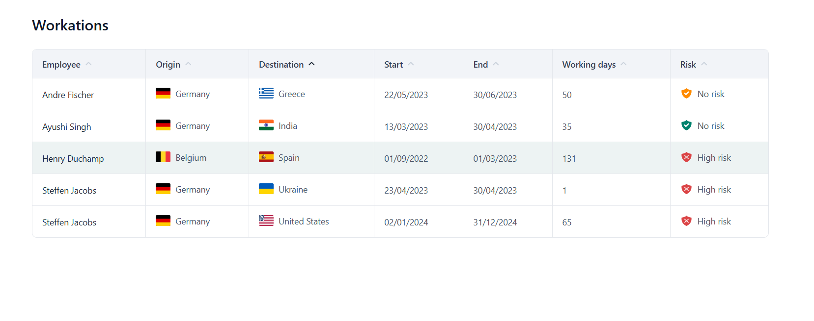
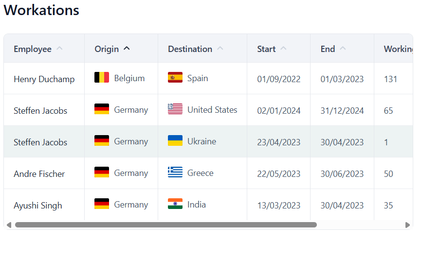

# Workations

A small full-stack app that shows workation stays in a sortable table.

On startup the backend reads `workations.csv` and imports it into an in-memory H2 database. The
Angular app then asks for `GET /workflex/workation` and renders what comes back.



## Running it

You need Java 25 and Node 22 or newer.

**Backend** (starts on port 8080):

```bash
cd backend
./gradlew bootRun
```

**Frontend** (starts on port 4200):

```bash
cd frontend
npm install
npm start
```

Then open http://localhost:4200.

The H2 console is at http://localhost:8080/h2-console if you want to check the imported rows.
Use `jdbc:h2:mem:workations` as the URL, user `sa`, and leave the password empty.

**Tests:**

```bash
cd backend  && ./gradlew test    # 25 tests
cd frontend && npm test          # 16 tests
```

## Versions and libraries

| Backend | |
|---|---|
| Java | 25 |
| Spring Boot | 4.1.1 |
| Gradle | 9.7.1 (Kotlin DSL) |
| Database | H2, in memory |
| OpenCSV | 5.10 — CSV parsing |
| MapStruct | 1.6.3 — entity to DTO mapping |
| Lombok | getters, builders, constructors |

| Frontend | |
|---|---|
| Angular | 22.1, zoneless |
| TypeScript | 6.0 |
| Styles | SCSS, no UI library |
| Vitest | 4.0 |
| Flags | flagcdn.com |

## How the code is organised

```
backend/src/main/java/com/workflex/workation/
├── domain/    the entity, the risk enum and the repository
├── csv/       everything about reading the file and importing it
├── service/   the DTOs, the mapper and the read service
└── web/       the controller and the CORS configuration

frontend/src/app/
├── models/      the shape of the data
├── services/    the HTTP call
└── components/  the table and its cells
```

## Technical decisions

**The primary key is not the one from the CSV.** `workationId` comes from another system, so it can
change format or be renumbered. A primary key is referenced everywhere and needs to be stable, so the
entity has its own generated `id` and keeps `workationId` as a unique indexed column.

**The key uses a sequence, not identity.** With `IDENTITY` the id is only known after the insert
runs, so Hibernate cannot group inserts and the configured batch size does nothing. With a sequence it
reserves ids up front and writes in batches.

**The import streams.** The parser hands rows to a consumer one at a time instead of returning a list,
and the importer writes them in batches of 500, flushing and clearing the persistence context after
each one. Memory use does not grow with the size of the file. With five rows this makes no difference,
but the design does not have to change if the file grows.

**A bad row is skipped, not fatal.** If a row has an unreadable date or a country that cannot be
resolved, it is logged and skipped, and the startup log says how many were skipped. Only an unreadable
file or one without a header stops the application. One broken row should not keep a service from
starting.

**The API does not return the entity.** There is a separate DTO, so the database schema can change
without breaking the client, and adding a column does not accidentally publish it. The client gets
`w1`, never the internal id.

**Labels and colours belong to the frontend.** The API sends `risk` as `HIGH_RISK`, `LOW_RISK` or
`NO_RISK`, and dates in ISO format. The frontend decides that two of those levels read as "No risk"
with different icons, and that dates are shown as `dd/MM/yyyy`.

**Sorting happens in the frontend.** The table keeps the chosen column in a signal, and the sorted
rows are a `computed` derived from it. The sorted array is never stored, so it cannot fall out of sync
with the data. The comparison itself is a pure function, which makes it easy to test.

**No UI component library.** The task was to match a screenshot, and with a component library most of
the time goes into overriding its default styles. The table is seven columns with sorting and a hover
state, which is little enough to write directly.

**CORS is configured in the backend, with the origin as a property.** A dev server proxy would only
work while running `ng serve`. The allowed origin changes between environments, so it lives in
configuration rather than in code.

## Responsive

Seven columns do not fit on a phone, and squeezing them makes the table unreadable. Instead the table
scrolls horizontally inside its own container, so the rest of the page stays put.



Sizes use `rem` rather than pixels, so the layout follows the browser's font size.

## Accessibility

- A real `<table>`, so screen readers announce rows and columns and let you move between cells.
- `scope="col"` on every header, so each cell is announced together with its column.
- `aria-sort` on the sorted header, which says whether it is ascending or descending. There is a test
  for this.
- Each header is a `<button>`, not a click handler on the `<th>`. A `th` cannot be focused with the
  keyboard, so without this the table could only be sorted with a mouse.
- The flags and the risk icons have an empty `alt`, because the country name and the risk label are
  right next to them. A description would make a screen reader read everything twice.

## Testing

41 tests in total.

**Backend (25).** The CSV parser is covered with a `StringReader`, including a field with a comma
inside quotes, and every way a row can be unusable. There is an integration test that starts the whole
application and calls the endpoint, plus a `@WebMvcTest` that checks the contract without a database.

**Frontend (16).** The sorting function is tested on its own: numbers compared as numbers, risk sorted
by severity rather than alphabetically, and the input array left untouched. The table component is
tested through clicks, so the toggle behaviour is covered. The risk cell has its own test because the
two levels sharing the label "No risk" is easy to break by accident.

## Out of scope

Pagination, authentication, CRUD endpoints and API documentation are deliberately not implemented.
They are not part of the task and would have used time better spent elsewhere.
